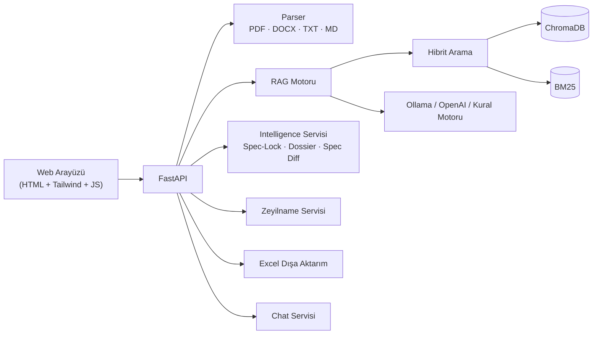

<div align="center">


# SpecMatrix AI

**Kurumsal İhale, Teknik Şartname Uyumluluk ve Teklif Mühendisliği Platformu**

Kanıt alıntılı hibrit RAG denetimi · Adrese teslim (Spec-Lock) tespiti · Otomatik resmi teklif cevap cetveli · 4 sayfalı Excel ihale paketi


</div>

---

## İçindekiler

- [Genel Bakış](#genel-bakış)
- [Temel Yetenekler](#temel-yetenekler)
- [Mimari](#mimari)
- [Hızlı Başlangıç](#hızlı-başlangıç)
- [Yapılandırma](#yapılandırma)
- [Kullanım Akışı](#kullanım-akışı)
- [Hazır Sektör Senaryoları](#hazır-sektör-senaryoları)
- [API Referansı](#api-referansı)
- [Proje Yapısı](#proje-yapısı)
- [Test](#test)
- [Tasarım Sistemi](#tasarım-sistemi)
- [Sorun Giderme](#sorun-giderme)
- [Notlar ve Sınırlamalar](#notlar-ve-sınırlamalar)

---

## Genel Bakış

SpecMatrix, bir ihale şartnamesindeki her maddeyi şirketinizin ürün katalogları ve politikalarıyla karşılaştırır. Her karar **dokümandan alınmış birebir alıntı ve sayfa referansıyla** desteklenir; kanıt bulunamayan madde asla "Tam Uyumlu" sayılmaz.

Tüm veri yerelde işlenir. Varsayılan yapılandırmada dış bir servise veri gönderilmez (yerel Ollama modeli).

## Temel Yetenekler

| Modül | Açıklama |
|---|---|
| **Hibrit RAG Denetimi** | `ChromaDB` vektör araması + `BM25` anahtar kelime araması, `RRF` ile birleştirilir. Sayfa ve bölüm metaverisi korunur. |
| **Sıfır Halüsinasyon Muhafızı** | `exact_quote` olmayan madde `TAM_UYUMLU` olamaz. Sayısal eşikler (`Gbps`, `°C`, `saat`, `m³/h`, `% SLA`) deterministik olarak doğrulanır. |
| **Spec-Lock Radarı** | Rekabeti tek üreticiye daraltan eşikleri ve ağırlaştırıcı hükümleri KİK m.12 ve TBK m.20-25 çerçevesinde `0-100` skorla işaretler. |
| **What-If Simülatörü** | Bir maddenin zeyilname veya ek teklifle çözüldüğünü varsayarak uyum skorunu ve karar rozetini anında yeniden hesaplar. |
| **Teklif Paketi ve BOM** | Madde madde resmi istekli taahhüdü, gap kapatma reçetesi, maliyet etkisi ve optimum ürün paketi; A4 PDF/yazdır çıktısı. |
| **Spec Diff** | Zeyilname öncesi (v1) ve sonrası (v2) şartnameleri karşılaştırır; esnetilen eşikleri ve uyum artışını gösterir. Özel v1/v2 metni de girilebilir. |
| **Zeyilname ve İtiraz Robotu** | Tek madde veya tüm gap/Spec-Lock maddeleri için resmi itiraz dilekçesi üretir. |
| **Doküman AI Asistanı** | İndekslenmiş dokümanlarla sayfa referanslı soru-cevap. |
| **İhale Portföyü** | Analiz edilen şartnameler arasında tek tıkla geçiş. |
| **4 Sayfalı Excel Paketi** | `Uyumluluk Matrisi` · `Resmi Teklif Cevap Cetveli` · `Gap Kapatma ve BOM` · `Rekabet Kısıtı (Spec-Lock)` |

### Denetim Motorları

| Motor | Hız | Kullanım |
|---|---|---|
| **Hızlı Kural Motoru** (varsayılan) | ~40 ms | Deterministik kural ve eşik denetimi; demo ve günlük kullanım. |
| **Yerel LLM (Ollama)** | CPU'da dakikalar | `llama3.2:3b` ile maddeleri model denetler; arayüzde motor seçicisinden açılır. |

## Mimari



## Hızlı Başlangıç

**Gereksinimler:** Python 3.10+; isteğe bağlı olarak [Ollama](https://ollama.com) ve `llama3.2:3b` modeli.

```powershell
# 1. Bağımlılıkları yükleyin
py -3 -m pip install -r requirements.txt

# 2. Ortam dosyasını oluşturun
Copy-Item .env.example .env

# 3. (İsteğe bağlı) Yerel modeli indirin
ollama pull llama3.2:3b

# 4. Uygulamayı başlatın
py -3 run.py
```

| Adres | Açıklama |
|---|---|
| http://127.0.0.1:8000 | Web arayüzü |
| http://127.0.0.1:8000/docs | Swagger / OpenAPI |

> [!TIP]
> Ollama kurulu değilse uygulama otomatik olarak Hızlı Kural Motoru ile çalışır.

## Yapılandırma

Ayarlar `.env` dosyasından okunur (`.env.example` şablonudur).

| Değişken | Varsayılan | Açıklama |
|---|---|---|
| `LLM_PROVIDER` | `ollama` | `ollama`, `openai` veya `mock` |
| `OLLAMA_BASE_URL` | `http://localhost:11434` | Ollama adresi |
| `OLLAMA_MODEL` | `llama3.2:3b` | Denetim modeli |
| `OLLAMA_TIMEOUT` | `120.0` | İstek zaman aşımı (sn) |
| `EMBEDDING_PROVIDER` | `deterministic` | `deterministic` (hızlı, yerel), `ollama`, `openai` |
| `OPENAI_API_KEY` | boş | Yalnızca `openai` sağlayıcısında gerekir |
| `MAX_UPLOAD_SIZE_MB` | `25` | Azami yükleme boyutu |
| `CHUNK_SIZE` / `CHUNK_OVERLAP` | `650` / `100` | Doküman bölme parametreleri |
| `HYBRID_VECTOR_WEIGHT` / `HYBRID_BM25_WEIGHT` | `0.5` / `0.5` | Hibrit arama ağırlıkları |
| `TOP_K_CHUNKS` | `3` | Madde başına getirilen blok sayısı |
| `HOST` / `PORT` | `127.0.0.1` / `8000` | Sunucu adresi |

> [!WARNING]
> `.env` dosyasını (özellikle `OPENAI_API_KEY`) sürüm kontrolüne eklemeyin.

## Kullanım Akışı

1. **Referans dokümanları yükleyin:** Ürün katalogları, datasheet'ler ve politikalar (PDF, DOCX, TXT, MD). Alternatif olarak `Demo Seti` ile örnekleri yükleyin.
2. **Şartnameyi seçin:** Hazır sektör kartlarından birine tıklayın ya da kendi şartnamenizi yükleyin/yapıştırın.
3. **Denetleyin:** Matris, uyum skoru, Spec-Lock rozetleri ve karar özeti oluşur. Bir satıra tıklayarak kanıt dosyasını açın.
4. **Aksiyon alın:** Teklif Paketi sekmesinden cevap cetvelini üretin, Zeyilname Robotu ile itiraz dilekçesi hazırlayın, Excel paketini indirin.

**Klavye kısayolları:** `/` veya `Ctrl+K` madde ara · `Esc` kanıt panelini kapat.

## Hazır Sektör Senaryoları

| Sektör | Şartname | Referans Dokümanlar |
|---|---|---|
| Savunma ve Siber Güvenlik | `Kamu_Siber_Guvenlik_Teknik_Sartnamesi.txt` | `AegisGuard_X500_Datasheet.txt`, `CloudSecure_Platform_Katalog.txt` |
| Sağlık ve Medikal | `Sehir_Hastanesi_Yogun_Bakim_Monitoru_Teknik_Sartnamesi.txt` | `VitaPulse_V8_Yogun_Bakim_Monitoru_Datasheet.txt` |
| İnşaat ve Mekanik Tesisat | `Havalimani_Mekanik_Havalandirma_Teknik_Sartnamesi.txt` | `AeroFlow_Pro_Endustriyel_HVAC_Katalog.txt` |
| Hukuk ve İhale Sözleşmeleri | `Kurumsal_BT_Hizmet_Alimi_Idari_ve_Hukuki_Sozlesme_Sartnamesi.txt` | `LexShield_Kurumsal_Hukuk_SLA_ve_KVKK_Politikasi.txt` |

Örnek veriler `data/sample_specs` ve `data/sample_docs` klasörlerindedir.

## API Referansı

| Yöntem | Uç Nokta | Açıklama |
|---|---|---|
| GET | `/api/health` | Sistem, LLM ve bilgi bankası durumu |
| GET | `/api/knowledge-base/stats` | İndekslenmiş doküman istatistikleri |
| GET | `/api/knowledge-base/chunks` | Metin bloklarını listeler |
| POST | `/api/knowledge-base/upload` | Doküman yükler ve indeksler |
| POST | `/api/knowledge-base/load-sample` | Örnek dokümanları yükler |
| DELETE | `/api/knowledge-base/documents/{doc_name}` | Tek dokümanı siler |
| DELETE | `/api/knowledge-base/clear` | Tüm indeksi sıfırlar |
| POST | `/api/analyze/sample?sector=&force_mock=` | Hazır sektör şartnamesini denetler |
| POST | `/api/analyze/upload` | Yüklenen veya yapıştırılan şartnameyi denetler |
| GET | `/api/risk-score` | Aktif analiz risk skoru |
| POST | `/api/chat` | Doküman asistanı (`force_mock` desteklenir) |
| POST / GET | `/api/proposal/dossier` | Resmi teklif cevap cetveli ve BOM |
| POST | `/api/spec-diff` | v1/v2 şartname karşılaştırması |
| POST | `/api/rebuttal/generate` | Tek madde itiraz dilekçesi |
| POST | `/api/rebuttal/batch` | Toplu zeyilname paketi |
| POST | `/api/export/excel` | 4 sayfalı `.xlsx` paketi |

Örnek:

```powershell
curl -X POST "http://127.0.0.1:8000/api/analyze/sample?sector=DEFENSE_IT&force_mock=true"
```

Geçerli `sector` değerleri: `DEFENSE_IT`, `HEALTHCARE_MEDTECH`, `CONSTRUCTION_HVAC`, `CONTRACTS_LEGAL`.

## Proje Yapısı

```text
SpecMatrix/
├── app/
│   ├── main.py                    # FastAPI uygulaması ve uç noktalar
│   ├── config.py                  # Ortam ayarları
│   ├── models/schemas.py          # Pydantic şemaları
│   ├── services/
│   │   ├── rag_engine.py          # Uyumluluk denetim motoru
│   │   ├── hybrid_search.py       # ChromaDB + BM25 + RRF
│   │   ├── intelligence_service.py# Spec-Lock, Dossier, Spec Diff
│   │   ├── rebuttal_service.py    # Zeyilname / itiraz üretimi
│   │   ├── chat_service.py        # Doküman asistanı
│   │   ├── export_service.py      # Excel paketi
│   │   └── parser_service.py      # PDF / DOCX / TXT ayrıştırma
│   └── static/                    # Arayüz (index.html, css, js, logo)
├── data/
│   ├── sample_docs/               # Örnek ürün dokümanları
│   └── sample_specs/              # Örnek şartnameler
├── tests/                         # Pytest paketi
├── run.py                         # Başlatıcı
├── requirements.txt
└── .env.example
```

## Test

```powershell
# Hızlı paket (canlı Ollama gerektirmez)
py -3 -m pytest tests/test_pipeline.py -k "not test_ollama_auditor_live_execution and not test_rag_compliance_engine_audit" -v

# Tam paket (Ollama çalışıyor olmalı; CPU'da uzun sürebilir)
py -3 -m pytest tests/test_pipeline.py -v
```

> [!NOTE]
> Testleri sunucu başlatma ile aynı anda çalıştırmayın; Windows'ta `data/vector_store` SQLite dosyası kilitlenebilir.

## Tasarım Sistemi

Arayüz iki temalı kurumsal bir sistem kullanır: **Executive Pearl** (açık, varsayılan) ve **Midnight Sapphire** (koyu). Tema sağ üstteki düğmeyle değiştirilir ve tarayıcıda saklanır. Tipografi: Plus Jakarta Sans, Inter, JetBrains Mono. Tüm sayfalar mobil, dizüstü ve masaüstü ekranlara uyumludur; `prefers-reduced-motion` desteklenir.

## Sorun Giderme

| Belirti | Çözüm |
|---|---|
| Analiz çok uzun sürüyor | Motor seçicisinden **Hızlı Kural Motoru**'nu seçin; yerel LLM CPU'da yavaştır. |
| `Ollama` durumu pasif | `ollama serve` çalıştığını ve `ollama pull llama3.2:3b` yapıldığını doğrulayın. |
| Arayüz eski görünüyor | `Ctrl+F5` ile önbelleği yenileyin. |
| Yükleme reddedildi | Dosya 25 MB altında ve PDF/DOCX/TXT/MD olmalı. |
| `vector_store` kilitli | Aynı anda tek süreç çalıştırın. |

## Notlar ve Sınırlamalar

- Üretilen teklif ve dilekçe metinleri **taslaktır**; resmî sunumdan önce hukuk ve teknik ekip incelemesi gerekir.
- Uyum kararı yalnızca yüklenen dokümanlardaki kanıta dayanır; doküman eksikse madde "Belirtilmemiş" olarak işaretlenir.
- Spec-Lock skoru yönlendiricidir, hukuki görüş değildir.
- Arayüz Tailwind ve Lucide için CDN kullanır; ilk açılışta internet bağlantısı gerekir.

## Lisans

[LICENSE](LICENSE) dosyasına bakın.
